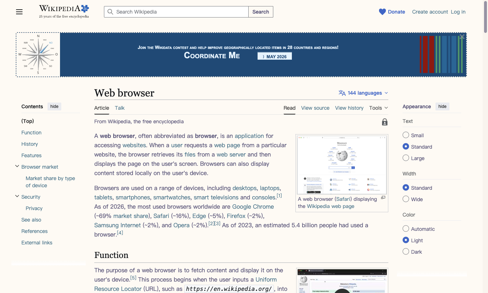
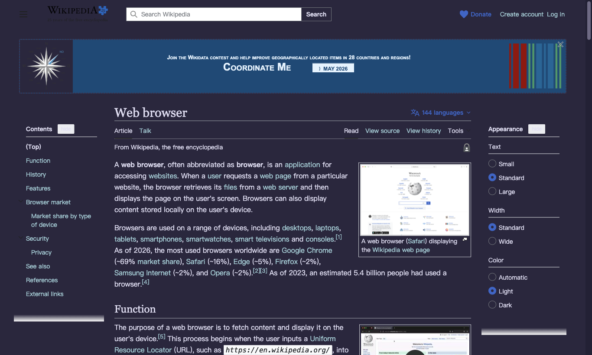
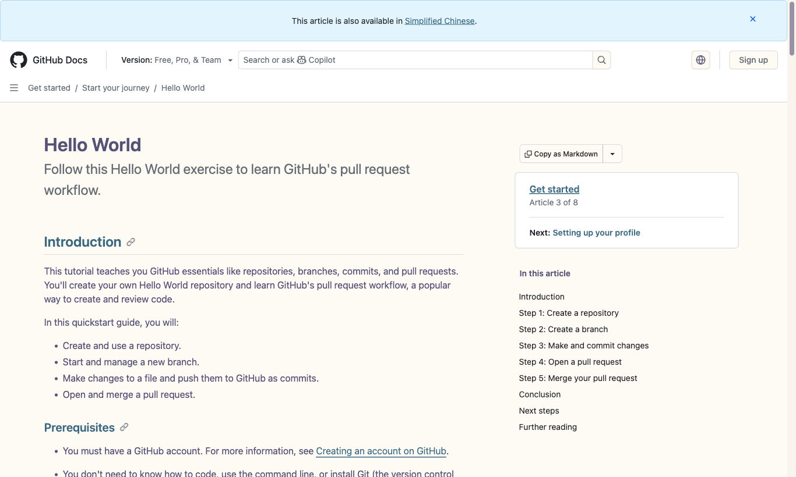
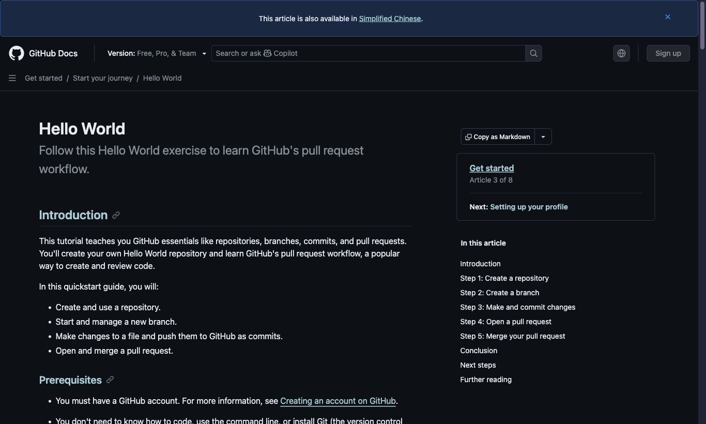
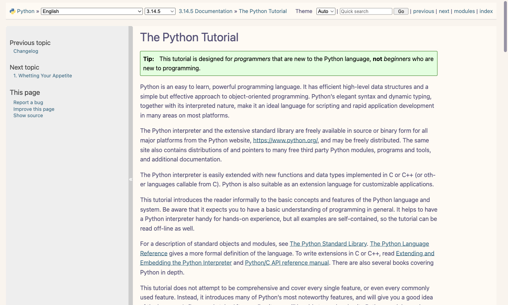
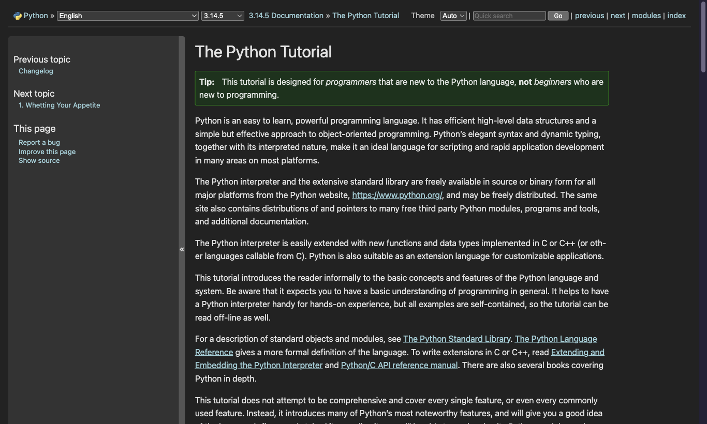
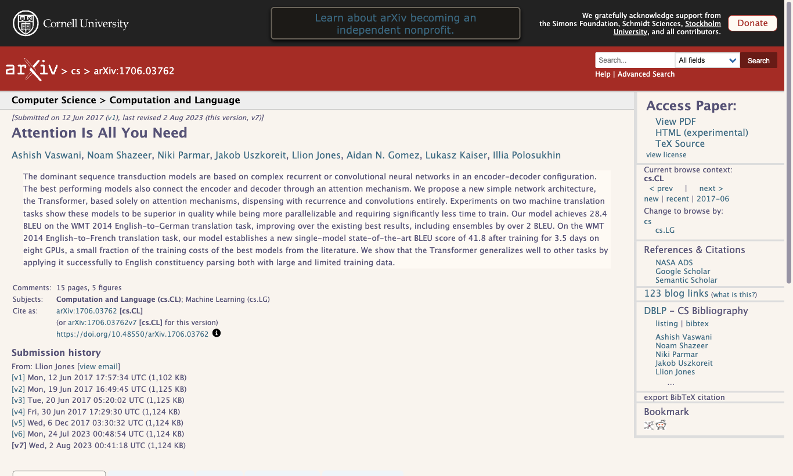
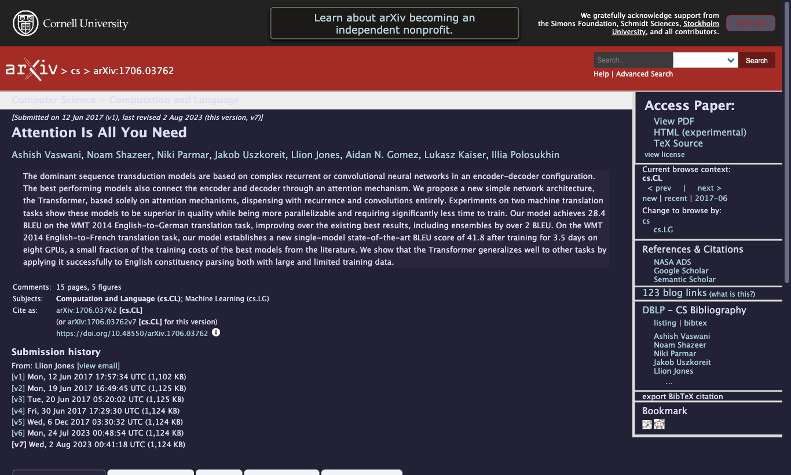

# Rosewash

Rosewash is a lightweight Manifest V3 browser extension that covers web pages
with restrained paper palettes. Rose Pine is the default; the popup also offers
the full set of Codex desktop app theme families (Catppuccin, Gruvbox, Nord,
Tokyo Night, Solarized, Dracula, GitHub, Linear, Notion, Raycast, Vercel, …).

It remaps page canvases, painted surfaces, neutral borders, and text into the
active palette so everyday browsing follows a calm paper tone instead of harsh
site defaults. Ordinary code and gradient text remain readable in the active
palette. Media, canvas, SVG, inputs, editors, and recognized syntax-highlighting
regions stay protected.

## Features

- Independent light and dark palette selectors (28 Codex-aligned families;
  default Rose Pine for both).
- Plain Light and Dark options appear first in their respective lists and
  preserve website colors. Switching to either restores previous tints;
  custom fonts and site layouts still follow their own settings.
- Appearance: Auto / Light / Dark. Auto uses the light or dark palette from
  the system color scheme.
- Optional English, Chinese, native MathML, and monospace fonts, selected from
  installed system fonts with live previews.
- Compact popup with appearance, palettes, Pick, and an Allowed / Blocked
  site button. Matching X or Zhihu layout controls appear on that site.
  Settings use Appearance, Fonts, Sites, and Shortcuts tabs with automatic
  saving; pending writes continue after the popup or settings page closes.
- Global enable switch, with the shortcut `Alt+Shift+P` to pause or resume.
- Toolbar icon fades when Rosewash is paused, off for the current site, or
  blocked by the browser.
- Pick element: click a part of a page that looks wrong to leave it, and
  everything inside it, untouched on that site. Manage ignored elements in
  the Sites tab of settings.
- Optional image dimming for dark palettes at 70, 80, or 90% brightness.
- Default on/off policy for new sites, plus a one-click switch per site.
  Explicit choices survive changes to the default. Settings lists manage
  always-on and always-off sites; remove a hostname to restore its inherited rule.
- Optional compact layout for X from 720px: collapsed navigation rail,
  adjustable centered timelines, and rail-based search. Thread pages stay
  native single-column.
- Optional Zhihu clean layout: center home, questions, and articles at your
  chosen reading width. Only articles hide the top bar; other pages keep
  navigation. Columns adapt to narrow windows and in-page navigation.
- Default shortcut `Alt+Shift+B` saves an on/off choice for the current site
  (Option+Shift+B on Mac) and applies it immediately. The Shortcuts tab lists
  both bindings and offers **Change shortcuts**.
- Full-page paper cover for light, dark, and cool-paper sites.
- Default transparent `html`/`body` canvases (legacy pages such as jmlr.org).
- Page-level headers and navigation bars blend into the active page base,
  including colored top bars such as arXiv's and Zhihu `AppHeader` shells
  (forced even when styled via CSS-in-JS).
- Root CSS custom property remapping for design-token backgrounds and text
  (`--ground`, `--ink`, ChatGPT surface tokens, Substack publication vars, …).
- CSS Color 4 parsing for `color(srgb ...)`, `lab()`, `oklab()`, `lch()`, and
  `oklch()` pages, including sRGB colors computed from `color-mix()` and
  relative RGB colors.
- Automatic tint repair after page loading, stylesheet updates, and element
  class changes, including during in-page navigation. Style updates repaint
  only the elements they affect, and large pages are tinted across frames.
- Embedded frames and open shadow roots follow the page palette and the
  current site's on/off rule.
- Media, canvas, SVG, inputs, editors, and syntax-highlighting region protection.
- No runtime dependencies or build step.

## Screenshots

| Site | Dawn | Moon |
| --- | --- | --- |
| [Wikipedia](https://en.wikipedia.org/wiki/Web_browser) |  |  |
| [GitHub Docs](https://docs.github.com/en/get-started/start-your-journey/hello-world) |  |  |
| [Python Docs](https://docs.python.org/3/tutorial/index.html) |  |  |
| [arXiv](https://arxiv.org/abs/1706.03762) |  |  |

## Install

Install [Rosewash from the Chrome Web Store](https://chromewebstore.google.com/detail/rosewash/jklllohlbljogmomdfhggfojpgellcmh).
Works in Chrome, Edge, Brave, Helium, and other Chromium browsers.

For manual installation, use a [GitHub Release](https://github.com/Yalyenea/rosewash/releases):

1. Open the [latest release](https://github.com/Yalyenea/rosewash/releases/latest).
2. Download `rosewash-vX.Y.Z.zip` (for example `rosewash-v0.2.0.zip`).
3. Extract the zip to a stable folder you will keep (do not delete it later;
   Chromium loads the extension from that path).
4. Open the extensions page:
   - Chrome / Brave / Helium: `chrome://extensions`
   - Edge: `edge://extensions`
5. Enable **Developer mode**.
6. Click **Load unpacked** and select the **extracted folder** that contains
   `manifest.json` (not the zip itself).

To update later: download the newer release zip, replace the extracted folder
contents, then click **Reload** on the extension card. Reload any already-open
tabs once so pages pick up the new content script.

Chrome may show a developer-mode warning on each browser restart. That is
expected for sideloaded extensions and is safe to dismiss.

## Install From Source

For local development:

1. Clone this repository.
2. Run `just dist` to stage a loadable folder.
3. Open `chrome://extensions` (or the equivalent page above).
4. Enable **Developer mode**.
5. **Load unpacked** and select the `dist/` folder (not the repo root).

Re-run `just dist` after source changes, then reload the extension.

After reloading the unpacked extension, reload any already-open test tabs once.
Chrome leaves old content scripts in existing page contexts after extension
reloads; Rosewash guards new scripts against that state and clears stale
Rosewash inline styles when the new script starts, but old injected scripts
cannot be patched in place.

## Custom Fonts

Open **Settings → Fonts** and enable **Custom fonts**. Installed system
fonts load automatically and changes save immediately. The extension needs
the browser's `fontSettings` permission to list fonts.

**Page default** preserves the website’s font for that category. MathML
fonts apply to native formulas; KaTeX, MathJax, SVG formulas, and code editors
keep their own typography. The monospace setting applies to code blocks and
other monospace text. Fonts must be installed on each device.

## Site Settings

**Enable new sites**, under **Settings → Sites**, controls sites without an
explicit rule. The popup's site button saves an on/off choice that survives
default changes. Remove the hostname from Always on or Always off to restore
its inherited rule.
Rules also cover subdomains; a more specific hostname rule takes priority,
and clearing it restores the parent rule if one exists.

The header switch pauses the entire extension, including sites set to always
on. Re-enabling it restores the saved site choices.

The settings page saves fields you edited and preserves changes made through
the popup or shortcut while the page was open. Adding a hostname to one list
replaces its opposite rule. If you explicitly include it in both lists,
Always off takes priority.

## Docs

- [AGENTS.md](AGENTS.md) — entry point for coding agents
- [docs/implementation.md](docs/implementation.md) — current implementation details
- [docs/architecture.md](docs/architecture.md) — conceptual layers
- [PLAN.md](PLAN.md) — roadmap

## Dev Loop

```sh
just test
just validate
just check
just dist
just package
just clean
```

`just dist` writes `dist/` for Load unpacked. `just package` runs the checks,
refreshes `dist/`, and writes `release/rosewash-vX.Y.Z.zip` for the Chrome
Web Store. `manifest.json` is at the root of that zip. `just clean` removes
`.tmp` and local browser-debug leftovers.

## Publishing Releases

GitHub Actions publishes a release zip whenever a version tag is pushed.
The release notes are the matching section from `changelog.md`; keep that
section short and user-facing.

1. Rewrite `## Unreleased` into a dated `## X.Y.Z` section of brief bullets.
2. Set the same version in `package.json` and `manifest.json`.
3. Tag and push:

```sh
git tag v0.2.0
git push origin v0.2.0
```

The workflow runs `just package`, then uploads `rosewash-v0.2.0.zip` and the
changelog notes to the matching GitHub Release. It can also be run manually
against an existing tag from the Actions tab.

## Palette

| Token | Dawn | Moon |
| --- | --- | --- |
| Base | `#faf4ed` | `#232136` |
| Surface | `#fffaf3` | `#2a273f` |
| Overlay | `#f2e9de` | `#393552` |
| Muted | `#9893a5` | `#6e6a86` |
| Text | `#575279` | `#e0def4` |

## Scope

Rosewash remaps page canvases, painted surfaces, text, and low-chroma borders
into the active Dawn or Moon palette. It samples common document roots and SPA
app roots so modern CSS and design-token pages are covered without URL-specific
rules. Media, canvas, SVG, inputs, editors, and recognized syntax-highlighting
regions stay protected. Complex
filter inversion and large site-specific rule packs are left for later versions.
Future versions should add more theme presets through a shared palette registry
instead of site-specific or theme-specific branches.

## License

MIT.
