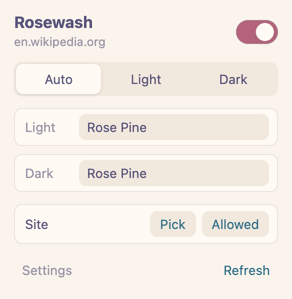
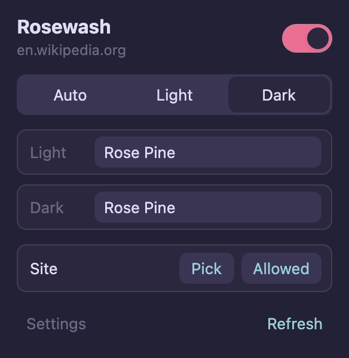
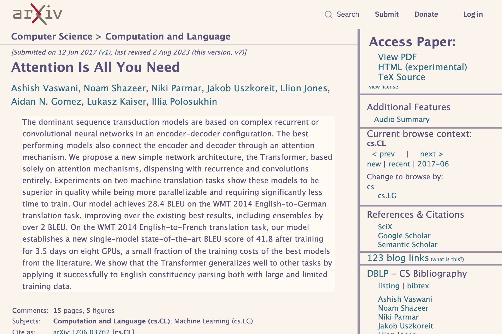
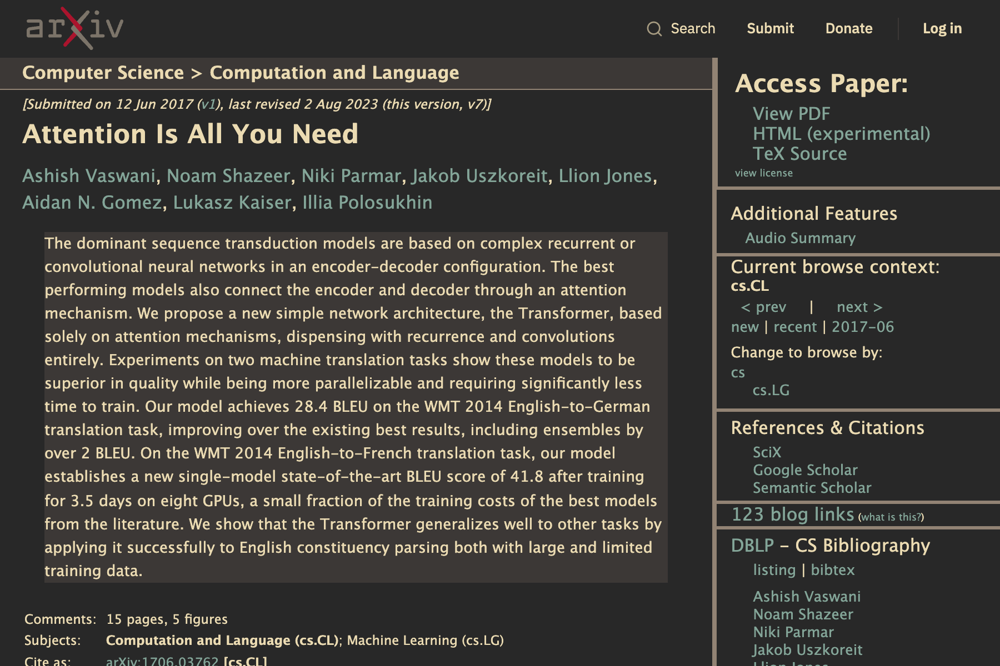
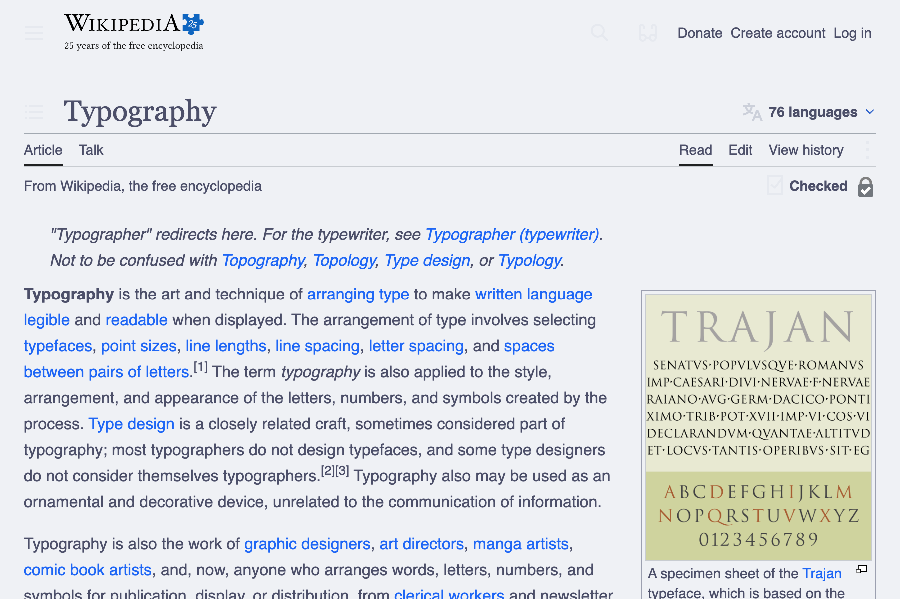
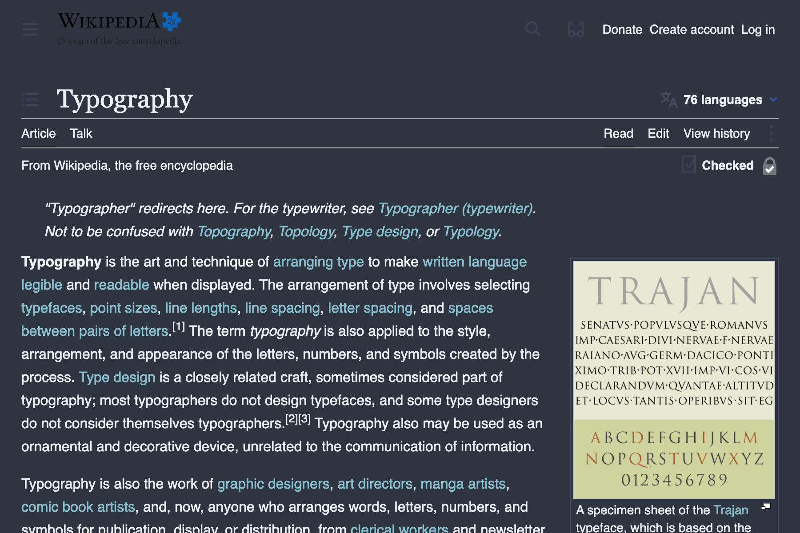
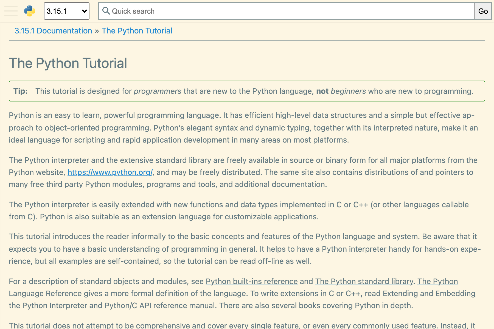
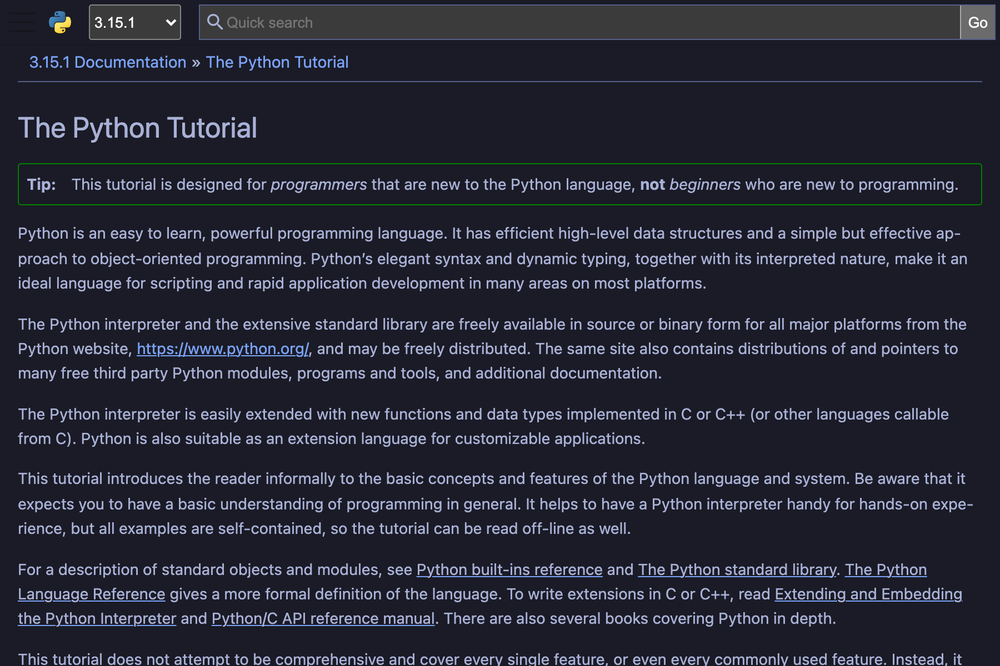

<h1 align="center">Rosewash</h1>

<p align="center">Your colors, fonts, and reading layouts across the web.</p>

<p align="center"><a href="https://rosewash.yfff.me/">Website · 官网</a></p>

<p align="center">
  
  
</p>

<h2 align="center">Install</h2>

<p align="center">
  <a href="https://chromewebstore.google.com/detail/rosewash/jklllohlbljogmomdfhggfojpgellcmh">Chrome Web Store</a> ·
  <a href="https://microsoftedge.microsoft.com/addons/detail/gjbmoakfjmbcnahoigepocgbngiekhjj">Edge Add-ons</a> ·
  <a href="https://addons.mozilla.org/en-US/firefox/addon/rosewash/">Firefox Add-ons</a>
</p>

<p align="center"><sub>Also supports compatible browsers such as Brave, Helium, and Zen. Firefox 148+.</sub></p>

<table align="center">
  <thead><tr><th>Light</th><th>Dark</th></tr></thead>
  <tr>
    <td align="center" width="50%">
      <a href="https://arxiv.org/abs/1706.03762">arXiv</a> · Rose Pine Dawn<br>
      <a href="docs/assets/screenshots/arxiv-rose-pine-light.png"></a>
    </td>
    <td align="center" width="50%">
      <a href="https://arxiv.org/abs/1706.03762">arXiv</a> · Gruvbox<br>
      <a href="docs/assets/screenshots/arxiv-gruvbox-dark.png"></a>
    </td>
  </tr>
  <tr>
    <td align="center" width="50%">
      <a href="https://en.wikipedia.org/wiki/Typography">Wikipedia</a> · Catppuccin<br>
      <a href="docs/assets/screenshots/wikipedia-catppuccin-light.png"></a>
    </td>
    <td align="center" width="50%">
      <a href="https://en.wikipedia.org/wiki/Typography">Wikipedia</a> · Nord<br>
      <a href="docs/assets/screenshots/wikipedia-nord-dark.png"></a>
    </td>
  </tr>
  <tr>
    <td align="center" width="50%">
      <a href="https://docs.python.org/3/tutorial/index.html">Python Docs</a> · Solarized<br>
      <a href="docs/assets/screenshots/python-solarized-light.png"></a>
    </td>
    <td align="center" width="50%">
      <a href="https://docs.python.org/3/tutorial/index.html">Python Docs</a> · Tokyo Night<br>
      <a href="docs/assets/screenshots/python-tokyo-night-dark.png"></a>
    </td>
  </tr>
</table>

## Features

- **Theme:** separate light and dark palettes, system appearance, and optional image dimming. Toggle theme overrides independently of fonts.
- **Fonts:** searchable English, Chinese, math, and monospace font choices in Chrome and Edge; installed font names in Firefox. Toggle fonts for the current site from the popup.
- **Control:** toggle theme and fonts independently by site, leave selected elements untouched with Pick (Esc to cancel), or pause everywhere.
- **Reading:** adjustable layouts for X and Zhihu, plus automatic expansion of X reply text.

Firefox's browser frame follows the palette. Matching Chrome and Edge frame themes are packaged separately. Reply expansion and frame themes are available in the current source; store releases may lag behind.

Open the toolbar popup to get started. **Settings** has fonts, site rules, layouts, and shortcuts.

## Store releases

Pushing a `v*` tag runs checks, builds the browser packages, publishes a GitHub
Release, and uploads Chrome, Edge, and Firefox updates in parallel for review.
Store approval and rollout happen after submission. The Release Zip workflow
also supports choosing a single store or packaging without store uploads.
An annotated tag containing an exact `[skip stores]` line publishes the GitHub
archives and skips all store uploads.
See [publishing setup](docs/implementation.md#store-publishing) for credentials
and read-only checks.

## Development

Plain JavaScript, no build step or runtime dependencies. Requires Node.js and [just](https://github.com/casey/just).

```sh
just check          # Tests and validation
just dist           # Chrome / Chromium → dist/
just dist edge      # Edge → dist-edge/
just dist firefox   # Firefox → dist-firefox/
just package-all    # Package extensions and Chromium frame themes
```

Load the staged folder as an unpacked extension; Firefox uses **Load Temporary Add-on** with its staged `manifest.json`. After changes, stage again, reload the extension, and refresh your tabs.

Open the [color mapping board](docs/color-mapping.html) locally to compare all
30 theme families. The standalone HTML works offline and supports zoom,
custom colors, and JSON export.

The bilingual website lives in `website/`. Cloudflare Workers Builds deploys
changes to `website/**` or `wrangler.website.jsonc` on `main` to
[rosewash.yfff.me](https://rosewash.yfff.me/). It has no build step; deployment uses
`npx wrangler@4.152.0 deploy --config wrangler.website.jsonc`.

[Releases](https://github.com/Yalyenea/rosewash/releases)
· [Implementation](docs/implementation.md)
· [Changelog](changelog.md)
· [MIT License](LICENSE)
